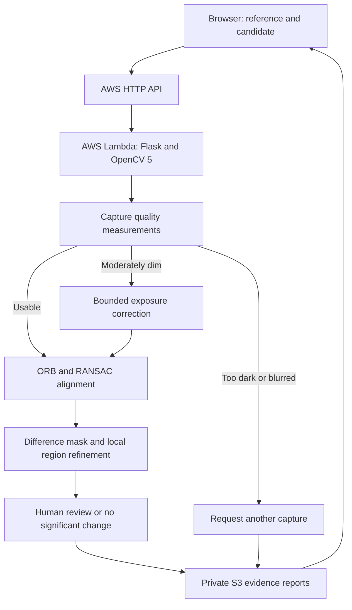
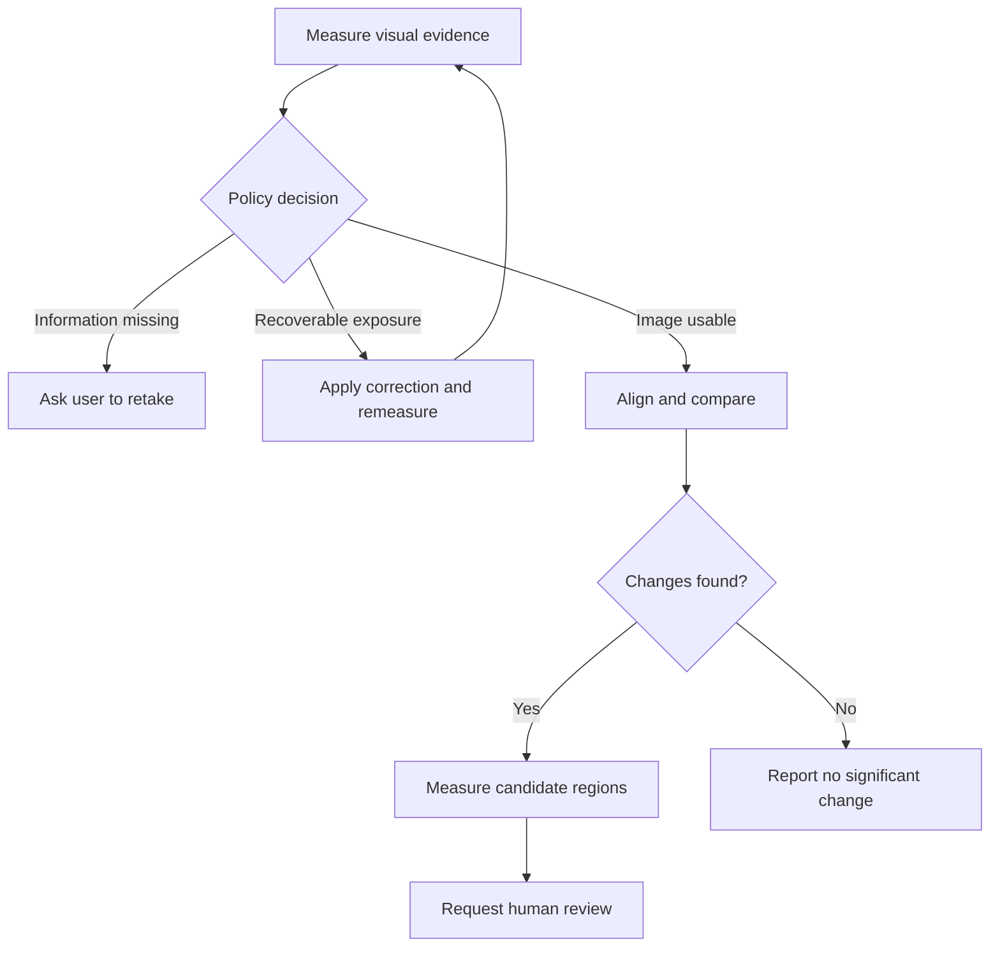

# Architecture

The cloud diagram describes the provided deployment design, not an already running deployment.

The recovery branch executes at most once. The policy does not loop indefinitely. A trace contains each measurement, tool choice, and action. Human review is recorded separately and never rewrites the machine observation.

In local mode, Flask serves both UI and API on localhost and `storage.py` writes JSON under `data/reports/`. In cloud mode, the same code runs in a Lambda container and writes private S3 objects. The API adapter handles JSON, base64 multipart uploads, and static asset responses. No database, external model API or GPU is required.
